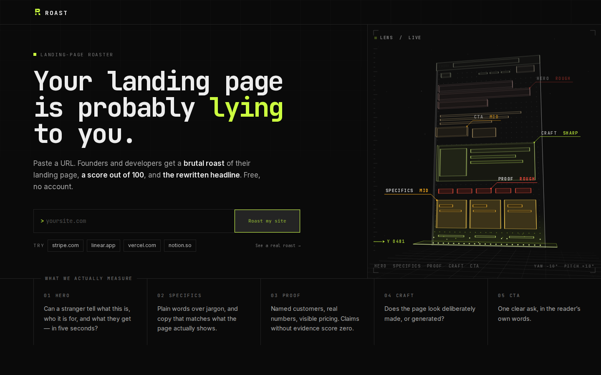

# Roast

[](./LICENSE)
[](https://roast.lightslips.ai)
[](https://github.com/charles161/roast/actions/workflows/ci.yml)

**Your landing page is probably lying to you.**

Paste a URL → in ~6 seconds get a sharp, specific roast of your messaging, a calibrated score out of 100 across five dimensions (**Hero / Specifics / Proof / Craft / CTA**), a side-by-side **glow-up** of your headline, subhead, and CTA, an AI-agent-ready fix prompt (plus `/r/<id>.md` for coding agents), and a shareable card with an auto-generated OG image.

Try it live at **[roast.lightslips.ai](https://roast.lightslips.ai)**.

<p align="center">
  
</p>

## Quick Start

```bash
git clone https://github.com/charles161/roast.git
cd roast
cp .env.example .env.local   # set GATEWAY_URL and GATEWAY_KEY
npm install
npm run dev                  # http://127.0.0.1:3042
```

For production:

```bash
npm run build
npm run start                # binds 127.0.0.1:3042
PORT=3099 npm run start      # custom port
```

### Environment Variables

See [`.env.example`](./.env.example). Keep secrets in `.env.local` (never committed, never sent to the browser):

| Variable | Meaning |
| --- | --- |
| `GATEWAY_URL` | OpenAI-compatible AI Gateway base URL or `/chat/completions` endpoint |
| `GATEWAY_KEY` | Gateway bearer token (server-side only; `AI_GATEWAY_API_KEY` also accepted) |
| `JEV_MODEL` | Evaluation model for rubric scoring (default `typesafe-ai/jev-1.14.0`) |
| `ROAST_MODEL` | Copy model for roast + glow-up (default `anthropic/claude-haiku-5.5`) |
| `DAILY_LLM_USD_CAP` | Hard daily LLM spend ceiling in USD (default `5`) |
| `PUBLIC_BASE_URL` | Optional absolute origin used in share links and OG metadata |
| `ROAST_CACHE_DIR` | Optional local cache directory (default `./.cache`) |
| `KV_REST_API_URL` / `KV_REST_API_TOKEN` | Optional Upstash / Vercel KV store (falls back to local disk when unset) |
| `POSTHOG_KEY` / `NEXT_PUBLIC_POSTHOG_KEY` | Optional PostHog analytics |

## How It Works

`POST /api/roast` runs the full pipeline server-side:

1. **Normalize** (`src/lib/url.ts`) — scheme, `www.`, tracking params, and param order collapse so one site maps to one cache key.
2. **SSRF guard** (`src/lib/ssrf.ts`, `src/lib/pinnedFetch.ts`) — `http(s)` only, web ports only, resolve-once IP pinning against DNS rebinding, private/loopback/link-local/CGNAT ranges rejected on *every* redirect hop.
3. **Fetch** (`src/lib/fetchPage.ts`) — 8s timeout, 2MB body cap, manual redirects, HTML content types only.
4. **Extract** (`src/lib/extract.ts`) — deterministic parse into structured `PageFacts` (zero LLM cost). All text is sanitized and length-capped before reaching any model.
5. **Lens** (`src/lib/lens.ts`) — deterministic detectors for the five-second test, jargon density, CTA audit, and AI-slop markers. Handed to the scorer as measured evidence rather than vibes.
6. **Score** (`src/lib/score.ts`) — Jev evaluates five ordered rubric ladders against that evidence, with automatic fallback to the deterministic rubric if Jev is unavailable.
7. **Write** (`src/lib/roast.ts`) — a single LLM call produces the roast lines, side-by-side glow-up, 3 concrete fixes, and an imperative coding-agent fix prompt as strict JSON.

Result pages live at `/r/<id>`, an agent-readable Markdown brief is served at `/r/<id>.md`, and social previews are rendered on-demand at `/api/og?id=<id>`.

## The Lens

Five weighted dimensions inspired by Raphael Schaad's landing-page rubric:

| Dimension | Weight | Question |
| --- | --- | --- |
| **Hero** | 30% | Can a stranger tell what this is, who it is for, and what they get in five seconds? |
| **Craft** | 25% | Does the page read as deliberately made, or generated? |
| **Specifics** | 20% | Plain words over jargon, and copy that matches what the page shows |
| **Proof** | 15% | Named customers, real numbers, visible pricing |
| **CTA** | 10% | One clear ask, in the reader's own words |

### Calibration

`tests/calibration.test.ts` anchors the rubric against captured real `PageFacts` fixtures (`stripe.com`, `linear.app`, `vercel.com`, `google.com`, and generated slop) so world-class pages score `~90+`, generated slop lands `30–48`, and bare app shells land `10–25`.

## Safety & Cost Guards

- **90-day cache + self-healing share links** — per-URL cache (KV or atomic local disk) plus a durable `id → URL` pointer so expired `/r/<id>` links regenerate cleanly on open.
- **Per-IP rate limits** — `10/min` and `60/hr` sliding windows (rejected requests don't extend the penalty).
- **Hard daily spend cap** — `DAILY_LLM_USD_CAP`, metered from real gateway usage; once reached, cached results keep serving while new roasts pause.

> **Deployment note:** Client IP is read from proxy headers (`x-real-ip` / `x-forwarded-for`). Deploy behind a trusted proxy (such as Vercel) that overwrites client IP headers.

## Testing

```bash
npm test            # 586 unit tests across 37 test files
npm run typecheck   # TypeScript strict check
npm run build       # Next.js production build
```

## License

[MIT](./LICENSE)
